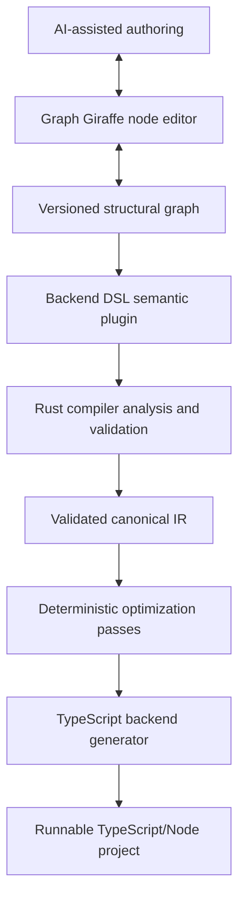

# Krunt

Krunt is a backend builder for visually authoring deterministic software systems. It is built on Graph Giraffe, the underlying domain-agnostic node editor library.

The visual graph is source code—not a diagram layered over handwritten code. A Rust compiler validates and lowers that graph into production-grade artifacts. Krunt's first target is a visual backend designer that generates a readable, deployable TypeScript/Node project.

> **Project status:** Architecture and product definition; implementation is beginning with the Rust IR crate.

## What we are building

Krunt lets a user design a backend by connecting typed nodes for routes, data, control flow, persistence, effects, responses, and error handling in the Graph Giraffe editor.

Users can:

- build a backend graph manually;
- ask AI to generate or extend a graph;
- see type, contract, dependency, and reachability errors before generation;
- compile the graph deterministically;
- export a human-readable backend codebase they own.

Krunt is not a proprietary low-code runtime or a general-purpose visual scripting language. Generated code must remain useful outside the tool.

## Architecture



Each layer has one responsibility:

| Layer | Owns | Must not own |
| --- | --- | --- |
| Editor | Canvas interaction and generic graph editing | Backend semantics or code generation |
| Structural graph | Nodes, ports, edges, subgraphs, IDs, and serialization | Domain or runtime behavior |
| Type system | Types, constraints, inference, and assignability | Backend-specific node rules |
| Plugin system | Semantic contracts, capabilities, effects, and extension points | Compiler orchestration |
| Backend DSL | Backend nodes, validation rules, and IR lowering | Editor UI or TypeScript rendering |
| Rust compiler | Pipeline orchestration, analysis, validation, and diagnostics | UI state or AI behavior |
| Canonical IR | Validated compiler representation and source mappings | Canvas or unresolved plugin state |
| TypeScript generator | Project layout, templates, dependencies, and formatting | Semantic inference |
| AI layer | Graph generation, completion, explanation, and proposals | Validation, compilation, or semantics |

The dependency direction points downward through these layers. The structural graph model must not depend on any semantic domain.

## Compiler pipeline

The Rust compiler follows an explicit pipeline:

```text
Versioned graph document
→ structural validation
→ plugin and node resolution
→ execution-flow and data-flow analysis
→ semantic analysis
→ type inference
→ contract and capability validation
→ whole-graph validation
→ canonical IR lowering
→ optimization
→ TypeScript generation
→ generated project
```

Compilation errors map back to stable graph element IDs. Invalid semantics cannot produce runnable output.

## Core principles

- **Graph as source:** the versioned graph is canonical; generated code is an artifact.
- **Deterministic compilation:** equivalent graphs produce identical paths and file contents.
- **Strong typing:** every data connection is checked before generation.
- **Separate flows:** execution edges schedule work; data edges transport values.
- **Domain-neutral core:** the editor and graph model contain no backend knowledge.
- **Plugin-owned semantics:** domains define node contracts, capabilities, effects, validation, and lowering.
- **AI assists:** AI may author graphs but cannot define correctness.
- **User-owned output:** generated projects are readable, runnable, and free of editor or AI dependencies.
- **No arbitrary graph code:** graphs do not execute arbitrary JavaScript.

## Backend DSL v1

The first semantic plugin is the Backend DSL.

| Family | v1 nodes |
| --- | --- |
| Entry | HTTP Route, Cron |
| Flow | Branch, Merge, Transform, Loop, Subgraph |
| Persistence | Entity, Repository, Query, Mutation |
| Effects | HTTP Request, Logging, Storage |
| Response | Success Response, Error Response |
| Error handling | Try/Catch, Validation Error |

WebSocket, Queue, GraphQL, RPC, first-class Transaction and Migration nodes, additional runtime targets, and non-backend DSLs are deferred beyond v1.

## Rust compiler layout

The planned Rust workspace separates compiler concerns into narrow crates:

```text
crates/
  graph-model/          Structural graph and serialization
  graph-types/          Type representation and inference
  diagnostics/          Stable source-linked diagnostics
  semantic-api/         Contracts, capabilities, and plugin interfaces
  compiler-core/        Pipeline orchestration and analysis
  krunt-ir/             Validated canonical IR
  compiler-passes/      Deterministic optimization passes
  backend-dsl/          Backend semantics and lowering
  codegen-typescript/   TypeScript project generation
  compiler-cli/         Command-line adapter
  compiler-wasm/        Optional browser validation adapter
```

This is the intended dependency structure, not a description of currently implemented crates.

## Repository structure

```text
.
├── AGENTS.md
├── README.md
├── .agents/
│   └── skills/         Agent-neutral development guidance by concern
└── plan/
    └── architecture/
        ├── RFC-001.md
        └── graph-giraffe-backend-tool-prd.pdf
```

## Development roadmap

1. Build the structural graph model, serialization, editor foundation, and undo/redo.
2. Add the type system, contracts, execution/data separation, subgraphs, and validation.
3. Implement the Rust compiler, canonical IR, diagnostics, and optimization passes.
4. Ship the Backend DSL and deterministic TypeScript backend generation.
5. Integrate prompt-to-graph, explanation, and fix-proposal AI workflows.
6. Harden the plugin SDK and extension boundaries.
7. Add more semantic domains without changing the graph core.

## Open decisions

The architecture intentionally leaves several decisions unresolved:

- Express, Fastify, or a framework-neutral TypeScript adapter;
- legal execution cycles and recursion;
- pull-based versus push-based data evaluation;
- async execution representation;
- public versus internal canonical IR;
- partial compilation behavior;
- generated-code regeneration and ownership;
- plugin sandboxing and distribution;
- composition of multiple DSLs in one graph.

These should be resolved deliberately through RFC or architecture-decision updates rather than indirectly through implementation.

## Documentation

- [Platform architecture RFC](plan/architecture/RFC-001.md)
- [Backend product requirements](plan/architecture/graph-giraffe-backend-tool-prd.pdf)
- [Krunt feature plan](plan/krunt-feature-plan.md)
- [Krunt reading list](plan/krunt-reading-list.md)
- [AI agent instructions](AGENTS.md)
- [Cross-layer development skill](.agents/skills/graph-giraffe-development/SKILL.md)

## Working with AI agents

The project provides portable, concern-specific skills under `.agents/skills/`. Agents should begin with `AGENTS.md`, load the cross-layer coordinator, and then load the skills for every architectural boundary affected by the task.
